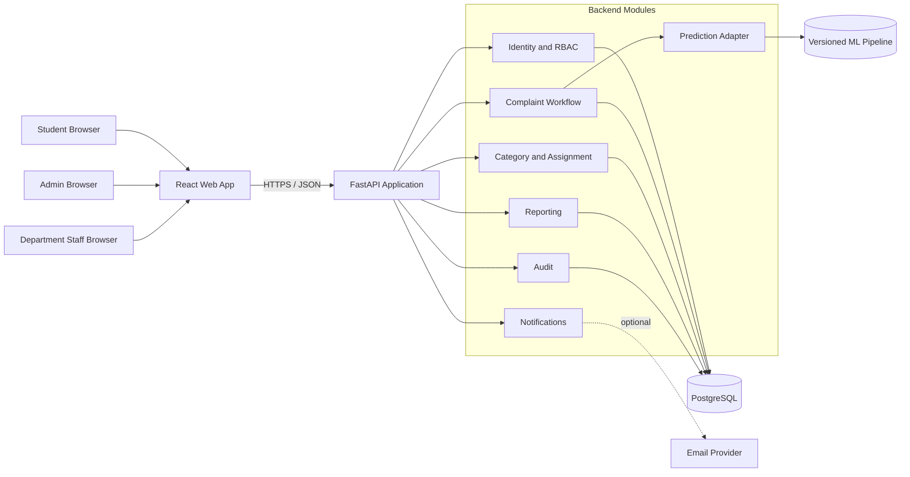
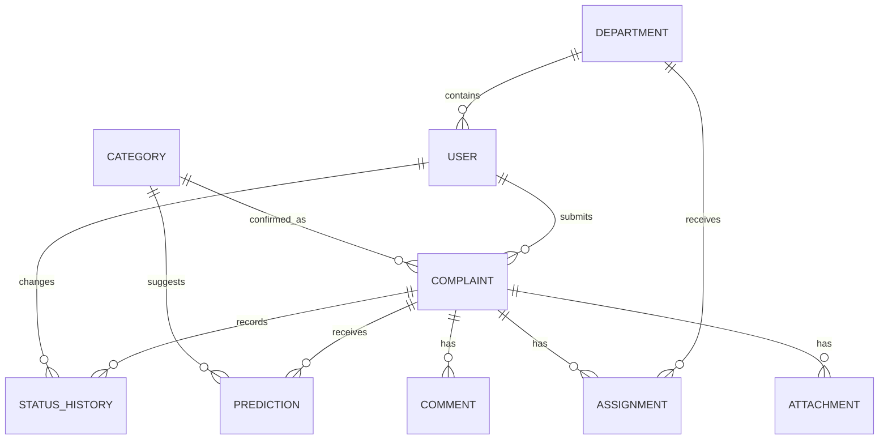
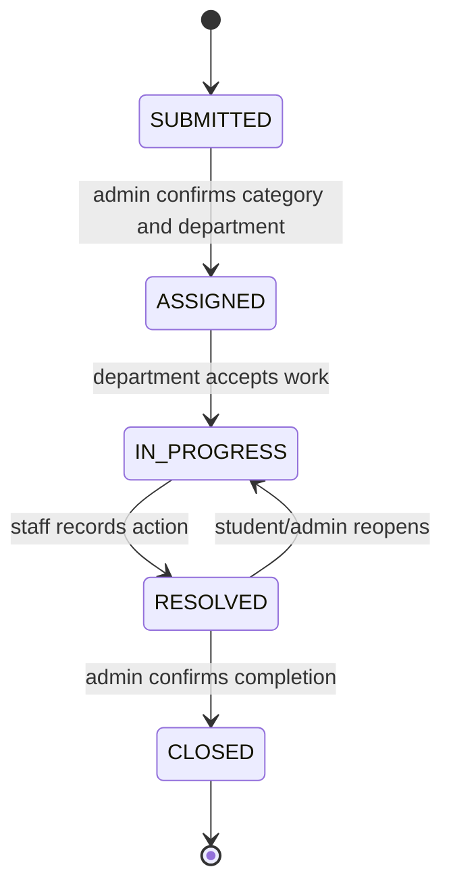
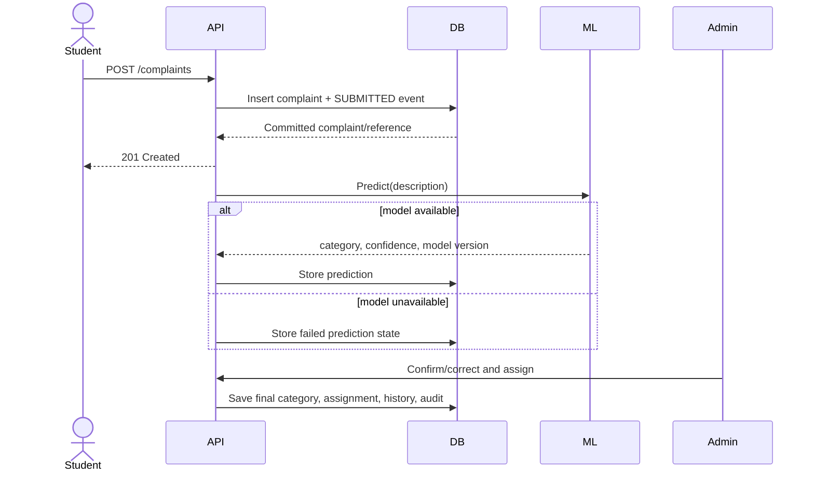

# Product Architecture Plan — College Complaint Management System

## 1. Recommended product name

### **CampusResolve**
**Tagline:** *Raise it. Route it. Resolve it.*

Why it fits: it is clear, professional, easy to remember, and broad enough to support complaints, service requests, analytics, and multiple campuses later.

Other options:

| Name | Positioning |
|---|---|
| CampusCare | Friendly and student-focused |
| GrievanceGrid | Formal and workflow-oriented |
| CampusVoice | Emphasises student feedback |
| ResolveU | Short and modern |
| UniFix | Informal and action-oriented |
| CampusTrack | Emphasises transparent tracking |

Before public launch, verify domain, app-store, social handle, and trademark availability.

---

## 2. What the document defines

The report describes a web platform with three user roles:

- **Student:** submits and tracks complaints.
- **Administrator:** reviews the ML suggestion, corrects the category, assigns a department, and closes complaints.
- **Department staff:** works assigned complaints, adds remarks, and updates progress.

The first release supports five categories: **Academics, Infrastructure, Hostel, Transport, and Administration**. It must keep a human administrator in the decision loop and must continue accepting complaints when the ML component is unavailable.

### Core success measures

- Students can submit a complaint in under two minutes.
- Every complaint receives a unique, non-guessable reference.
- Students can see the latest status without contacting staff.
- Every status/category/assignment change is auditable.
- Administrators can correct ML predictions.
- The ML outage does not block complaint submission.
- The percentage of predictions accepted without correction can be measured.

---

## 3. Architecture decision

### Start with a modular monolith, not microservices

For an initial college deployment and student project, separate microservices add deployment, networking, monitoring, and consistency problems without a proven scaling need. Build one backend with clear internal modules and keep the ML training code separate. The prediction pipeline can run inside the backend initially and be extracted into a service later without changing the client API.

### Recommended stack

| Layer | Choice | Reason |
|---|---|---|
| Web client | React + TypeScript + Vite | Fast development, reusable role-based UI, strong typing |
| UI | Tailwind CSS or Material UI | Responsive and accessible components |
| Backend API | Python 3.12 + FastAPI | Validation, generated OpenAPI docs, and direct ML integration |
| ORM/migrations | SQLAlchemy 2 + Alembic | Explicit relational models and repeatable schema changes |
| Database | PostgreSQL | Transactions, filtering/reporting, full-text capability, JSON where useful |
| ML | scikit-learn Pipeline | TF-IDF and classical classifier in one versioned artifact |
| Background work | In-process job for MVP; Redis/Celery only when needed | Avoid premature infrastructure |
| Testing | Pytest, Vitest, Playwright | Unit, API integration, and end-to-end coverage |
| Packaging | Docker Compose | Reproducible local/demo environment |
| CI | GitHub Actions | Lint, test, build, migration checks |

A server-rendered FastAPI/Jinja application is a valid simpler alternative if delivery time is very short. Do not use a separate Node backend merely to serve the React application; one Python API keeps the system smaller.

---

## 4. Logical architecture



### Runtime rules

1. The backend is the only component allowed to enforce permissions and workflow transitions.
2. A complaint is committed to PostgreSQL before prediction is attempted.
3. If prediction fails, the complaint remains `SUBMITTED` with `prediction_status=FAILED`; an administrator categorises it manually.
4. Every category, assignment, status, and visibility change creates an immutable audit event.
5. ML output is a suggestion only. Assignment uses the administrator-confirmed category.

---

## 5. Backend module boundaries

```text
backend/
  app/
    auth/             # sign-in, password/SSO integration, role checks
    users/            # profiles and account administration
    complaints/       # create, read, workflow transitions
    categories/       # categories and category-to-department routing
    departments/      # departments and staff membership
    predictions/      # model loading, inference, confidence, versions
    comments/         # student-visible and internal remarks
    attachments/      # upload metadata and access controls (phase 2)
    reports/          # aggregate queries and exports
    notifications/    # event-driven email notifications
    audit/            # append-only activity history
    core/             # configuration, errors, database, security
  ml/
    train.py
    evaluate.py
    data_validation.py
    artifacts/
```

Keep domain logic in service classes/functions, not API route handlers. API handlers validate input, call the domain service, and serialize the response.

---

## 6. Data model

The report's proposed schema is a useful baseline, but the production schema should separate workflow events, predictions, and assignments.

### Main entities

| Entity | Important fields |
|---|---|
| `users` | id, institutional_id, name, email, password_hash/SSO_subject, role, department_id, active, created_at |
| `departments` | id, code, name, contact_email, active |
| `categories` | id, code, name, description, default_department_id, active |
| `complaints` | id (UUID), reference_code, student_id, title, description, location, final_category_id, assigned_department_id, priority, status, created_at, updated_at, resolved_at, closed_at, version |
| `predictions` | id, complaint_id, category_id, confidence, model_version, prediction_status, created_at, error_code |
| `assignments` | id, complaint_id, department_id, assigned_by, assigned_at, ended_at |
| `status_history` | id, complaint_id, from_status, to_status, remark, changed_by, changed_at |
| `comments` | id, complaint_id, author_id, body, visibility (`STUDENT_VISIBLE`/`INTERNAL`), created_at |
| `attachments` | id, complaint_id, object_key, original_name, content_type, size, uploaded_by, scan_status |
| `audit_events` | id, actor_id, action, resource_type, resource_id, metadata, created_at |
| `model_versions` | id, version, metrics, category_schema_version, artifact_hash, activated_at, retired_at |

### Important constraints and indexes

- Unique: `users.institutional_id`, `users.email`, `complaints.reference_code`.
- Index complaint lists by `(student_id, created_at)`, `(assigned_department_id, status, created_at)`, and `(status, created_at)`.
- Use UUIDs internally and a separate display reference such as `CR-2026-8F4K2P`; never expose sequential database IDs.
- Use optimistic locking (`complaints.version`) to prevent two staff members overwriting each other's updates.
- Do not overwrite prediction history when a model is rerun.
- Avoid hard deletion of complaints and audit records; apply an approved retention/anonymisation policy.

### Relationship summary



---

## 7. Complaint workflow



Recommended additions to the report:

- `REJECTED`: duplicate, invalid, or outside institutional scope; must include a reason.
- `REOPENED` can be represented by moving `RESOLVED -> IN_PROGRESS` and recording the event.
- Priority: `NORMAL`, `HIGH`, `URGENT`; urgency is staff-confirmed, never solely ML-decided.
- Define service-level targets by category/priority later, rather than embedding deadlines in code.

### Transition permissions

| Transition | Allowed role |
|---|---|
| Create `SUBMITTED` | Student |
| `SUBMITTED → ASSIGNED` | Administrator |
| `ASSIGNED → IN_PROGRESS` | Assigned department staff |
| `IN_PROGRESS → RESOLVED` | Assigned department staff |
| `RESOLVED → IN_PROGRESS` | Student (within configured window) or administrator |
| `RESOLVED → CLOSED` | Administrator |
| Any allowed transition with override | Administrator, with mandatory reason and audit entry |

---

## 8. API plan

Use `/api/v1` from the first release and publish the generated OpenAPI definition.

### Student

- `POST /api/v1/auth/login`
- `GET /api/v1/me`
- `POST /api/v1/complaints`
- `GET /api/v1/complaints?mine=true`
- `GET /api/v1/complaints/{complaintId}`
- `POST /api/v1/complaints/{complaintId}/comments`
- `POST /api/v1/complaints/{complaintId}/reopen`

### Administrator

- `GET /api/v1/admin/complaints?status=&category=&department=&from=&to=`
- `PUT /api/v1/admin/complaints/{id}/classification`
- `POST /api/v1/admin/complaints/{id}/assignments`
- `POST /api/v1/admin/complaints/{id}/transitions`
- `GET /api/v1/admin/reports/summary`
- CRUD endpoints for categories, departments, and staff accounts

### Department staff

- `GET /api/v1/staff/complaints`
- `POST /api/v1/staff/complaints/{id}/transitions`
- `POST /api/v1/staff/complaints/{id}/comments`

Do not expose `/predict` publicly. Prediction should be an internal application operation to prevent abuse, data leakage, and bypassing complaint creation.

### Create-complaint sequence



Prediction may be synchronous immediately after the database commit for the MVP. Move it to a durable background queue only when latency or reliability measurements justify it.

---

## 9. Authentication, privacy, and security

### Minimum controls

- Prefer institutional SSO/OIDC when available. For the prototype, use Argon2id password hashing, short-lived access sessions, secure `HttpOnly`, `SameSite` cookies, and CSRF protection.
- Enforce RBAC and ownership checks in every backend query.
- Department staff can access only currently assigned complaints.
- Add rate limits to sign-in, submission, comment, and attachment endpoints.
- Validate text lengths and allowed attachment types; store files outside the web root and malware-scan them before access.
- Escape output and use parameterised ORM queries; apply a strict Content Security Policy.
- Encrypt traffic with HTTPS and encrypt backups/storage at rest.
- Never log complaint descriptions, passwords, tokens, or sensitive attachment contents.
- Separate `INTERNAL` staff comments from student-visible updates.
- Provide a prominent urgent/safety route that bypasses routine ML routing.
- Mask names, IDs, email addresses, and phone numbers before using complaint text in training.
- Document retention, access, export, correction, and anonymisation rules with the institution.

### Sensitive complaints

Add a `confidential` flag and a restricted handling group for complaints involving harassment, discrimination, health, safety, or discipline. Normal department staff and dashboards must not automatically receive these records.

---

## 10. ML architecture and evaluation

### Baseline pipeline

```text
Input text
  -> validation
  -> optional PII masking
  -> TF-IDF (word unigrams + bigrams)
  -> candidate classifier
  -> category + confidence/decision score + model version
```

Compare:

1. Multinomial Naive Bayes (baseline)
2. Logistic Regression with class weights
3. Linear SVM; calibrate only if a meaningful confidence score is required

### Data rules

- Write a category annotation guide before collecting labels.
- Use anonymised, institution-approved records only.
- Deduplicate before splitting so near-identical complaints cannot leak into train and test sets.
- Use stratified train/validation/test splits; cross-validation if data is limited.
- Fit the vectorizer on training data only.
- Report per-class precision/recall/F1, macro-F1, weighted-F1, confusion matrix, dataset size, and label distribution.
- Do not deploy based on accuracy alone.

### Deployment gate

Until there is sufficient verified data, run the system with **manual category selection** and collect administrator-confirmed labels. Enable ML suggestions only after offline evaluation. A reasonable initial gate is a stakeholder-approved macro-F1 target plus acceptable recall for every safety-relevant class; the college must choose the exact thresholds.

### Production monitoring

Track:

- Prediction acceptance/correction rate overall and per category.
- Low-confidence frequency.
- Category distribution drift.
- Model failures and prediction latency.
- Performance on a periodically reviewed, newly labelled sample.

Version the full scikit-learn pipeline, category schema, preprocessing code, metrics, training-data snapshot/hash, and artifact checksum. Never retrain directly from unreviewed student text.

---

## 11. User experience plan

### Student screens

1. Sign in
2. Dashboard: active and past complaints
3. New complaint: title, description, location, optional attachment
4. Submission confirmation with reference
5. Complaint timeline with public remarks and reopen action
6. Urgent/sensitive help guidance

### Administrator screens

1. Work queue with filters and aging indicators
2. Complaint detail with prediction, confidence, and model version
3. Confirm/correct category and assign department
4. Full timeline and audit view
5. Category/department/status trend dashboard
6. Category, routing, user, and model configuration

### Department screens

1. Assigned work queue
2. Complaint detail with allowed data only
3. Start work, add public/internal remarks, resolve

Build mobile-first, keyboard-accessible interfaces with clear error messages. Do not rely on colour alone for status.

---

## 12. Delivery roadmap

### Phase 0 — Discovery and governance (3–5 days)

- Confirm categories, department ownership, status definitions, and escalation policy.
- Decide SSO vs prototype credentials.
- Define complaint retention and sensitive-complaint access rules.
- Produce annotation guide and UX wireframes.
- Agree acceptance criteria and deployment environment.

### Phase 1 — Foundation (1 week)

- Create React, FastAPI, PostgreSQL, Docker Compose, migrations, and CI.
- Implement users, roles, departments, categories, authentication, and seed data.
- Add structured logs, health checks, error handling, and OpenAPI docs.

### Phase 2 — Core complaint MVP (1–2 weeks)

- Student create/list/detail flows and unique references.
- Admin queue, category confirmation, assignment.
- Department queue, status transitions, comments.
- Status history, audit events, authorization tests.
- ML-independent fallback behavior.

### Phase 3 — ML baseline (1 week after data is available)

- Build anonymisation and dataset validation scripts.
- Train/evaluate three baseline models.
- Register the selected artifact and integrate the prediction adapter.
- Add prediction review and acceptance-rate reporting.

### Phase 4 — Hardening (1 week)

- End-to-end, concurrency, security, accessibility, and recovery tests.
- Add notifications and safe attachments if required.
- Backup/restore test, operational runbook, admin guide, and user guide.
- Pilot with a small authorised group.

### Phase 5 — Pilot and iteration (2–4 weeks)

- Measure submission, assignment, and resolution times.
- Review misclassifications and category ambiguity.
- Fix workflow friction; retrain only with reviewed labels.
- Decide whether queues, SSO, multi-campus support, and duplicate detection are justified.

---

## 13. Test and acceptance plan

### Required automated tests

- Unit: validators, reference generation, transition rules, preprocessing.
- Authorization: every role/resource combination, including cross-student and cross-department access.
- Integration: database migrations, complaint creation, prediction success/failure, assignment, timeline.
- Contract: OpenAPI request/response schemas.
- End-to-end: student submission through admin assignment and department resolution.
- ML: deterministic preprocessing, artifact compatibility, no train/test leakage, metric generation.
- Security: brute-force throttling, CSRF, XSS payloads, malicious uploads, ID enumeration.
- Recovery: backup restore and ML-unavailable submission.

### MVP definition of done

- All eight functional requirements in the report are implemented.
- Unauthorized cross-user and cross-department reads are denied.
- A failed model call never loses or blocks a complaint.
- Every workflow change includes actor and timestamp.
- Core end-to-end tests pass in CI.
- A fresh environment can start using documented commands and migrations.
- No unsupported model-performance claims appear in the report or UI.

---

## 14. Scope control

### Build in MVP

Authentication, three roles, complaint submission, category confirmation, department assignment, legal status transitions, student tracking, remarks, audit history, responsive UI, and ML fallback.

### Defer until evidence supports it

Microservices, chat, mobile apps, multilingual models, multi-label classification, automated urgency decisions, semantic duplicate detection, real-time sockets, and advanced management analytics.

This keeps CampusResolve deliverable while preserving clean extension points for later releases.
